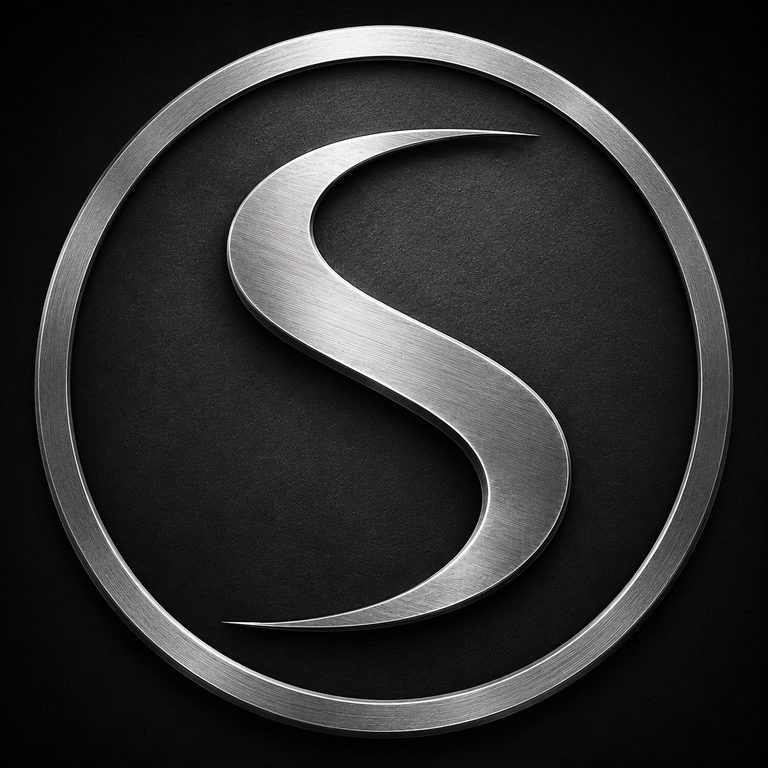
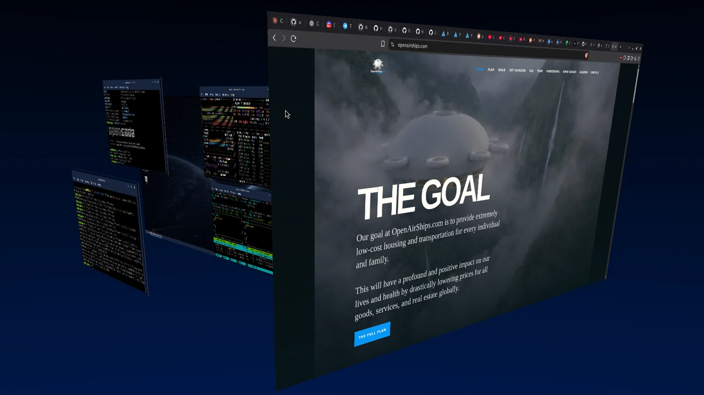
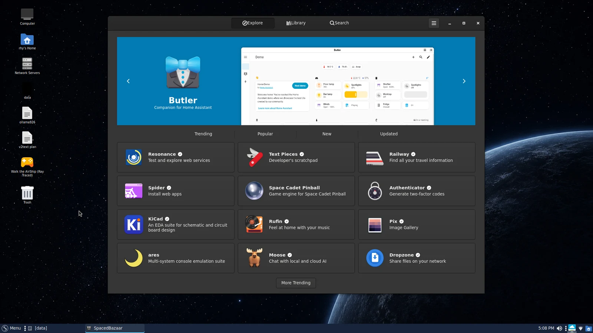
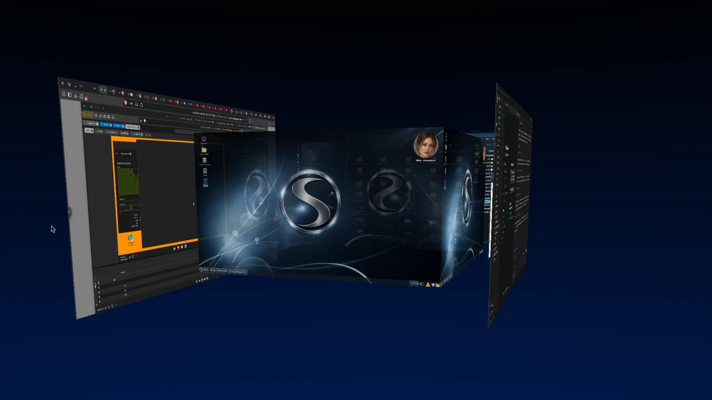
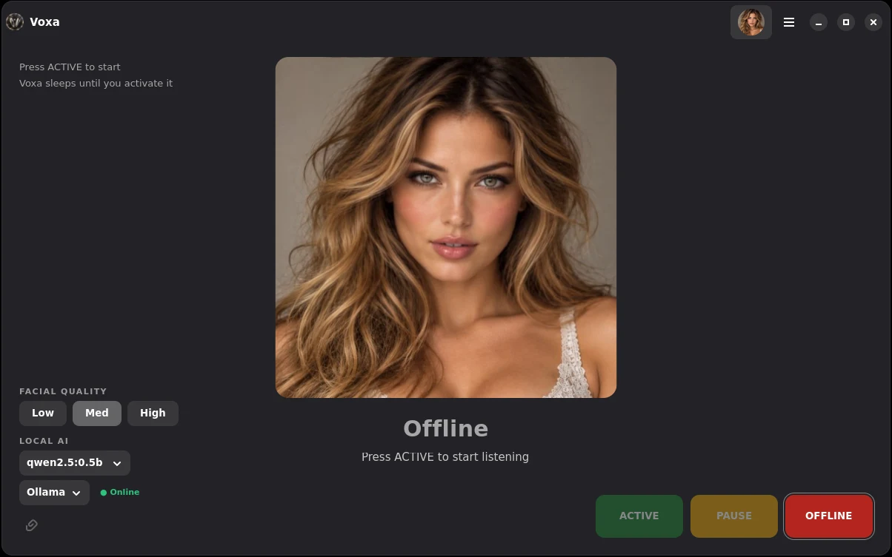
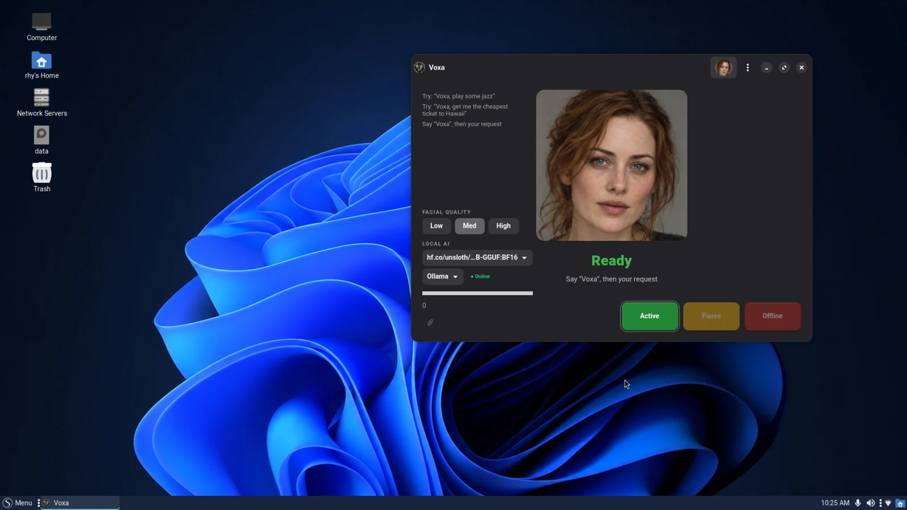
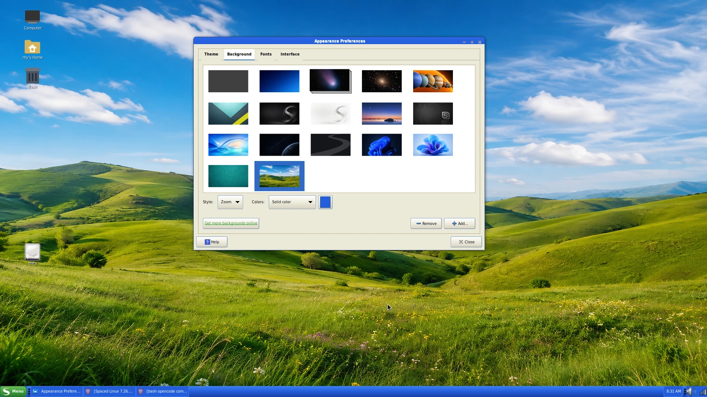
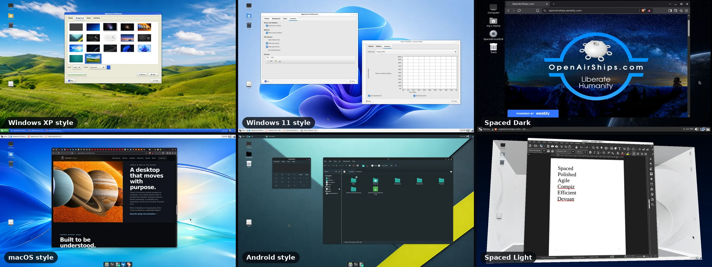

<p align="center">
  <a href="https://spacedlinux.com">
    
  </a>
</p>

<h1 align="center">Spaced Linux 11.26.1</h1>

<p align="center"><strong>Spaced. Polished. Agile. Compiz. Efficient. Devuan.</strong></p>

<p align="center">
  A beautiful, familiar, systemd-free Linux desktop for beginners, power users,<br>
  and anyone who wants their computer to feel like their own.
</p>

<p align="center">
  <a href="https://spacedlinux.com"><strong>Website</strong></a> ·
  <a href="https://spacedlinux.com/help.html"><strong>Help</strong></a> ·
  <a href="https://discord.gg/BMW9Y6NB3y"><strong>Discord</strong></a> ·
  <a href="https://t.me/+pjmFzHo-i9A2ZWY5"><strong>Telegram</strong></a> ·
  <a href="https://github.com/crhy/spaced/releases"><strong>Download releases</strong></a> ·
  <a href="https://distrowatch.com/table.php?distribution=spaced"><strong>DistroWatch</strong></a> ·
  <a href="https://github.com/crhy/spaced/issues"><strong>Issues</strong></a> ·
  <a href="docs/DESIGN.md"><strong>Design</strong></a> ·
  <a href="docs/MATE-theming.md"><strong>Themes</strong></a> ·
  <a href="#support-spaced-linux"><strong>Support</strong></a>
</p>

<p align="center">
  <a href="CHANGELOG.md"><strong>11.26.1 changes</strong></a>
</p>

<p align="center">
  
  
  
  
  
  
  
</p>

<p align="center">
  <a href="website/assets/screenshots/desktop-compiz.webp">
    
  </a>
</p>

## Linux that feels familiar. Freedom that goes deeper.

Spaced Linux is a polished desktop distribution built on **Devuan Ceres**, using **sysvinit**, **MATE**, and **Compiz**. It welcomes first-time Linux users without hiding the system from experienced users who want to inspect, customize, automate, and rebuild it.

The desktop begins with a familiar layout: a clear application menu, conventional windows, readable controls, and tools placed where people expect them. Beneath that approachable surface is a lean Devuan base, a deeply configurable Compiz desktop, signed Flatpak repositories, a graphical Calamares installer, and a reproducible live-build workflow.

Compiz is not an optional novelty. It is the window manager and compositor, providing smooth animation, flexible workspace behavior, window rules, accessibility features, and the visual personality that makes Spaced Linux feel alive.

## Spaced Linux in action

These are real Spaced Linux desktop sessions—not wallpaper mockups. Click any image to view it at full size.

<table>
  <tr>
    <td width="50%" align="center">
      <a href="website/assets/screenshots/desktop-compiz.webp"></a><br>
      <sub><strong>Compiz-first desktop</strong> — Workspaces, accessibility, motion, and organization are part of the core experience.</sub>
    </td>
    <td width="50%" align="center">
      <a href="website/assets/screenshots/desktop-welcome.webp?v=11.26.1"></a><br>
      <sub><strong>Friendly first run</strong> — Install the suggested apps, or just the ones you want, from one clear welcome screen.</sub>
    </td>
  </tr>
  <tr>
    <td width="50%" align="center">
      <a href="website/assets/screenshots/desktop-bazaar.webp"></a><br>
      <sub><strong>Modern applications</strong> — Flatpak, Flathub, and the signed Spaced Linux catalog provide current software without dependency chaos.</sub>
    </td>
    <td width="50%" align="center">
      <a href="website/assets/screenshots/desktop-theme-cube-dark.webp"></a><br>
      <sub><strong>Coordinated themes</strong> — GTK, icons, wallpaper, panels, and Compiz presentation move together.</sub>
    </td>
  </tr>
  <tr>
    <td width="50%" align="center">
      <a href="website/assets/themes/theme-macos.webp"></a><br>
      <sub><strong>A familiar favorite</strong> — The macOS-inspired theme is one of the many coordinated Spaced Linux desktop looks.</sub>
    </td>
    <td width="50%" align="center">
      <a href="website/assets/screenshots/voxa-grace.webp"></a><br>
      <sub><strong>Private AI</strong> — <a href="https://voxaai.me">Voxa</a> hears you on this computer and opens apps, takes dictation and answers questions by voice.</sub>
    </td>
  </tr>
  <tr>
    <td width="50%" align="center">
      <a href="website/assets/themes/theme-win11dark.webp"></a><br>
      <sub><strong>Windows 11 dark</strong> — A modern dark look inspired by Windows 11, coordinated across GTK, icons, and panels.</sub>
    </td>
    <td width="50%" align="center">
      <a href="website/assets/themes/theme-winxp.webp"></a><br>
      <sub><strong>Windows XP</strong> — A nostalgic Windows XP-style desktop that stays fast and familiar.</sub>
    </td>
  </tr>
</table>

## Why beginners feel at home

| Feature | Benefit |
|---|---|
| **Familiar desktop** | A classic desktop workflow avoids the learning curve of unfamiliar shells. |
| **Graphical installation** | Calamares provides a clear installation path for BIOS and UEFI systems. |
| **Useful defaults** | Networking, audio controls, archives, editing, document viewing, and system utilities are ready immediately. |
| **Modern applications** | Welcome installs SpacedBazaar and suggested apps after setup, keeping large Flatpak runtimes out of the base image. |
| **Coordinated themes** | One choice coordinates GTK, icons, folder colors, wallpaper, panel behavior, and the optional dock. |

## Why advanced users keep control

| Feature | Benefit |
|---|---|
| **Systemd-free architecture** | Devuan Ceres and sysvinit keep service management conventional, understandable, and scriptable. |
| **APT plus Flatpak** | Use native packages for the operating system and sandboxed apps for fast-moving desktop software. |
| **Deep Compiz configuration** | Tune effects, window rules, workspaces, keybindings, accessibility, and compositor behavior. |
| **Reproducible builds** | The repository contains the live-build configuration, package selection, overlays, scripts, and QEMU targets used to make the ISO. |
| **Plain-text configuration** | Themes, package groups, desktop defaults, and automation remain inspectable and version controlled. |
| **A practical customization base** | Fork it, rebuild it, replace the artwork, alter package groups, or turn it into another focused distribution. |

## A desktop with range

Spaced Linux combines a modern system with visual ideas from the best desktop eras. Its theme collection can evoke classic Windows, macOS, Android, Linux Mint, GeoWorks, or the distinctive monochrome Spaced identity without becoming a fragile pile of unrelated tweaks.

<p align="center">
  <a href="website/assets/screenshots/desktop-themes-six.webp">
    
  </a>
</p>

## Core components

- **Base:** Devuan Ceres (unstable), rolling release
- **Init:** sysvinit
- **Desktop:** MATE
- **Primary window manager:** Compiz
- **File manager:** Caja
- **Application menu:** Brisk Menu
- **Display manager:** LightDM GTK Greeter
- **Installer:** Calamares
- **Icons:** Spaced overlays based on Papirus
- **Application delivery:** APT plus Flatpak, Flathub, and the signed `spaced-github` catalog
- **First run:** standalone [`spaced-welcome`](https://github.com/crhy/spacedwelcome) Debian package
- **Application catalog:** [`SpacedBazaar`](https://github.com/crhy/spacedbazaar), installed after Calamares through Welcome
- **Target architecture:** amd64

## Download Spaced Linux

**Spaced Linux 11.26.1 is the current release.** Download the ISO and its checksum from the [Spaced Linux 11.26.1 release page](https://github.com/crhy/spaced/releases/tag/v11.26.1).

11.26.1 updates the November 2026 release line. Its changes are listed in the [changelog](CHANGELOG.md).

Verify the download on Linux:

```bash
sha256sum -c spaced-linux-11.26.1-amd64.iso.sha256
```

Test release images in a virtual machine or on non-critical hardware before adopting them for daily use.

### What you need

- A 64-bit (amd64) PC with BIOS or UEFI firmware.
- One USB stick of 2 GB or more. Everything on the stick is erased.
- The ISO is about 1.6 GB.
- Tested configuration: 4 GB RAM, 4 CPU cores, 25 GB of free disk space, and a
  1440×900 display. That is the virtual machine this release is tested in, not
  a measured minimum.
- The NVIDIA driver installer needs Secure Boot switched off in the firmware.

### Try it and install it

Write the ISO to the stick with Rufus on Windows, or balenaEtcher on Windows,
Mac, or Linux. Restart with the stick plugged in, choose it in the boot menu
(often F12, F9, or Esc), and pick **Start Spaced Linux**. The live desktop runs
from the stick and changes nothing on your disk, so you can look around first.
Back up your own files before you install. When you are ready, open
**Install Spaced Linux** on the live desktop; it starts the Calamares installer,
which asks where Spaced Linux should go. If the stick will not boot, the live
menu entries and how to read a failed boot are in
[docs/BOOTING.md](docs/BOOTING.md). The same steps are on the
[help page](https://spacedlinux.com/help.html). The live session signs in as
**user** with password **1**, the root account uses **spaced**, and `sudo` needs
no password there; those passwords exist only on the stick, and an installed
system uses the ones you choose in the installer. The stick is also a rescue
system: its recovery tools (GParted, TestDisk, ddrescue, `smartctl`) stay on
the stick, and the installer removes them so an installed system does not get
them.

### Keep it updated

Open **Spaced Update** from the menu. It refreshes the APT package lists,
upgrades the system from Devuan and the signed Spaced Linux repository, and
updates Flatpak apps and runtimes. In a terminal the equivalent is:

```bash
sudo apt update && sudo apt full-upgrade
```

Restart after a kernel or graphics driver update, because the new one is not
used until the machine restarts.

### Get help or report a bug

Ask on [Discord](https://discord.gg/BMW9Y6NB3y) or
[Telegram](https://t.me/+pjmFzHo-i9A2ZWY5), or read the
[help page](https://spacedlinux.com/help.html). For a bug, open a
[GitHub issue](https://github.com/crhy/spaced/issues) with: the Spaced version
(`cat /etc/os-release`), whether you are on a live USB or an installed system,
the steps that reproduce it, what you expected instead, and the output of
`spaced-graphics-report` for any display problem. Report security problems
through [SECURITY.md](SECURITY.md) instead of a public issue.

## Build Spaced Linux

A Devuan- or Debian-based build host is recommended.

```bash
git clone https://github.com/crhy/spaced.git
cd spaced
make deps
make release
```

ISO preparation intentionally stops when a standalone component or signing
key is still marked `UNRELEASED`. See the
[application delivery guide](docs/APPLICATION-DELIVERY.md#release-pins-and-local-development)
for release pins and verified local overrides.

The completed ISO is written beneath:

```text
build/iso/
```

### Test in QEMU

```bash
make iso-test
```

For unattended boot checks, including VirtualBox BIOS and EFI, run:

```bash
make iso-smoke
```

The smoke tests pass only after SSH and the complete MATE desktop (session,
panel, Caja, and Compiz) are running. The VirtualBox smoke test then launches
the live installer (`/usr/local/bin/install-spaced-linux`, the same command
the desktop launcher runs) over SSH, waits up to 90 seconds for a Calamares
process and a visible Calamares window, screenshots it, and closes it without
installing. KVM and VirtualBox screenshots are saved
beneath `build/test-artifacts/`; VirtualBox also rejects blank captures.

VirtualBox graphics profiles (`scripts/vm/virtualbox/smoke-iso.sh
--graphics default|vboxsvga`, or `SPACED_VBOX_GRAPHICS`):

```bash
make vbox-smoke          # VBoxSVGA: must reach a usable desktop (exit 0)
make vbox-smoke-default  # VirtualBox's own default graphics controller
```

`vbox-smoke-default` exercises the configuration real users get and records
the controller VirtualBox chose (VBoxVGA on VirtualBox 7.2.16, which reaches a
usable desktop). It exits 3 with a `NO WINDOW MANAGER` diagnosis when Compiz
cannot start on that controller (issue #218). Both profiles run the
installer launch check once the desktop is reached.

### Useful targets

```bash
make check
make help
make deps
make iso-build
make iso-test
make iso-smoke
make vm-start
make release
make clean
make cache-clean
```

QEMU defaults to a 1440×900 GTK window and forwards guest SSH to port `2222`.

## Support Spaced Linux

Spaced Linux is an independent project. Donations help cover hosting, testing, hardware, development time, and future releases.

<table>
  <tr>
    <td width="50%" align="center" valign="top">
      <a href="https://mempool.space/address/bc1q3kgsasmwyc2knfa8snzqstr7m983sxwleql7l2">
        
      </a><br>
      <strong>Bitcoin</strong><br>
      <code>bc1q3kgsasmwyc2knfa8snzqstr7m983sxwleql7l2</code>
    </td>
    <td width="50%" align="center" valign="top">
      <a href="https://venmo.com/u/green-jacket">
        
      </a><br>
      <strong>Venmo</strong><br>
      <code>@green-jacket</code>
    </td>
  </tr>
</table>

Thank you for helping keep an independent, polished, systemd-free desktop available to everyone.

## Project status

The current release is **11.26.1**, the first patch release of the **11.26** line. Spaced Linux is an independent community project under active development.

The [11.26.1 release audit roadmap](docs/ROADMAP.md) lists what is still open and planned for later releases.

## Contributing

Find desktop instructions in [Spaced Help](https://spacedlinux.com/#help) or open **Spaced Linux Help** to reach Welcome's local Help tab. Join the community on [Discord](https://discord.gg/BMW9Y6NB3y) or [Telegram](https://t.me/+pjmFzHo-i9A2ZWY5) for setup questions and testing discussions.

Bug reports, documentation improvements, Compiz refinements, theme work, package suggestions, hardware testing, accessibility improvements, and build fixes are welcome.

Report a bug in an [issue](https://github.com/crhy/spaced/issues): give the Spaced version, say whether it is a live or installed session, and list the steps that reproduce the problem. Report a security problem through [SECURITY.md](SECURITY.md) instead of a public issue.

Send a pull request with a short description of what changed and how it was tested.

The [application delivery architecture](docs/APPLICATION-DELIVERY.md) documents
the standalone Welcome package, post-install SpacedBazaar, signed first-party
Flatpak catalog, release pins, and end-to-end tests.

### Theme development

The theme documentation is split by purpose:

- [MATE theme architecture](docs/MATE-theming.md) — component ownership, runtime switching, source-to-installed workflow, testing, and troubleshooting.
- [Theme and interface colors](docs/THEME-COLORS.md) — GTK2/GTK3 palettes, controls, panels, decorations, icons, wallpapers, terminal, Compiz, Flatpak, and toolkit limits.
- [MATE panel layout](docs/matepanel.md) — applets, layouts, orientation, panel backgrounds, and Cairo Dock.
- [Visual design](docs/DESIGN.md) — current design principles for the Spaced identity and OS-inspired themes.
- [Resolution record](docs/FIXES.md) — current resolutions for recurring historical problems.

Run `make check` before committing theme or documentation changes.

For maintenance across the distribution, see [CONTRIBUTING.md](CONTRIBUTING.md),
the [documentation index](docs/README.md), the [user upgrade guide](docs/UPGRADE.md),
the [subsystem map](docs/SUBSYSTEMS.md),
[Compiz architecture and upstream strategy](docs/COMPIZ.md), and
[10.26.6 post-release issue audit](docs/10.26.6-POST-RELEASE-AUDIT.md).

### NVIDIA recovery guide

Spaced Linux includes a verified, transactional NVIDIA driver installer with automatic rollback, pre-reboot verification, and post-reboot desktop checks. For installation steps, SSH recovery procedures, DKMS troubleshooting, Secure Boot limitations, and the full error-code reference, see:

- [docs/NVIDIA-RECOVERY.md](docs/NVIDIA-RECOVERY.md)

### Boot and installation troubleshooting

The live boot chain, its difference from a stock Devuan live system, historical boot failures, and how to diagnose a live USB that will not boot are documented in:

- [docs/BOOTING.md](docs/BOOTING.md)

## Acknowledgements

Spaced Linux builds on the work of the Devuan, Debian, MATE, Compiz, Calamares, Flatpak, Papirus, and broader free-software communities.

## License

Project-specific build configuration and code are released under the [rhY License 1.0](LICENSE): do whatever you want with it, but if you share it, or anything built from it, you must share your complete source under the same terms. The GNU GPL, version 3 or later, is the fallback. Upstream packages, artwork, themes, fonts, and components retain their respective licenses.
