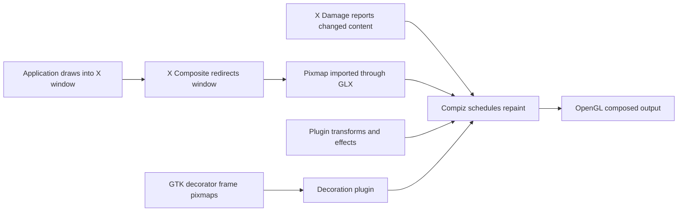

# Compiz in Spaced Linux

Source review: 23 October 2026, against the shipped 10.26.6 tree. This is a
maintenance guide; proposed work below is not a claim that it already ships.
See the [release evidence](10.26.6-RELEASE-REVIEW.md) and
[post-release issue audit](10.26.6-POST-RELEASE-AUDIT.md).

## Which Compiz, and who owns what?

Spaced ships the Reloaded C implementation, Debian/Ceres `2:0.8.18-9`
rebuilt as `2:0.8.18-9+spaced10.26.6`. Ubuntu's C++ 0.9 implementation is a
different codebase; patches and plugin compatibility cannot be assumed to
transfer between them. Marco remains a packaged dependency and supplies
decoration-theme code through libmarco. A Marco theme setting does not mean
Marco is managing the desktop.

| Layer | Responsibility and source |
|---|---|
| MATE session | Starts the required `spaced-window-manager`, selected by `overlays/usr/share/glib-2.0/schemas/90_spaced-linux.gschema.override` |
| Spaced launcher | `overlays/usr/local/bin/spaced-window-manager`: startup probe, failure notice and bounded restart delay |
| Compiz core | Owns X window management, redirected window textures, composition and input dispatch |
| Plugins | Wrap core hooks and add decoration, movement, effects, workspace cube, zoom and other behavior |
| Configuration | `ccp`, libcompizconfig and the seeded INI profile select plugins and options |
| Decoration | `spaced-window-decorator` supervises `gtk-window-decorator --replace`; GTK/libmarco draw theme frames, Compiz's decoration plugin consumes their pixmaps |
| Wallpaper | MATE settings daemon; normal theme switching does not restart Compiz, Caja or the panel |

The decorator's autostart entry and Compiz's decoration command both use
`spaced-window-decorator`. Its per-display flock permits one supervisor;
children close descriptor 9 so they cannot strand the lock. It retries
nonzero exits with a delay capped at 30 seconds while X is alive. This is
separate from the window-manager supervisor.

## How a window reaches the display



In the pinned source, `src/display.c` and `src/window.c` manage Composite
redirection, `src/screen.c` sets up rendering, and `src/texture.c` imports
pixmaps. Damage events identify changed content; repaint scheduling and
plugin hooks determine the final composition. Plugins commonly use
`WRAP`/`UNWRAP` to interpose on core functions, so activation and ordering
matter. An individual application's redraw, the decorator's redraw, and
Compiz's repaint are distinct operations.

The decorator publishes frame data and pixmap identifiers using the
libdecoration protocol. The compositor imports those resources. A pixmap ID
is not ownership of the underlying resource: the other X client can destroy
it between requests. This distinction explains the 10.26.6 race below.

## Configuration that actually ships

The seed is `overlays/etc/skel/.config/compiz/compizconfig/Default.ini`,
installed as `~/.config/compiz/compizconfig/Default.ini`. The companion
`config` selects the INI backend, MATE integration and plugin autosorting.
This is not the `.config/compiz-1` layout. Existing users receive selected
default migrations through `overlays/usr/lib/spaced-linux/migrate-desktop.py`;
replacing their entire profile would discard customization.

The active plugin list is:

```text
core ccp commands decoration fade firepaint glib matecompat minimize
mousepoll move neg obs place png regex resize screenshot snap svg workarounds
cube 3d focuspoll rotate scale ezoom switcher
```

Sections for `wobbly`, `animation` and `expo` exist, but those plugins are not
in the active list. A section alone does not enable an effect. The profile
uses four horizontal workspaces and one vertical workspace. Useful defaults:

| Action | Binding / implementation |
|---|---|
| Move window | Alt + left drag, `move` |
| Resize window | Super + right drag, `resize` |
| Zoom | Shift + Super + wheel, or Up/Down, `ezoom` |
| Compiz screenshot selection | Ctrl + Shift + left drag, `screenshot` |
| MATE screenshot selection | Shift + Print, `mate-screenshot --area` |
| Terminal | Ctrl + Alt + T, `matecompat` |

The two screenshot paths have different behavior. Issue
[#305](https://github.com/crhy/spaced/issues/305) requests feedback for the
Compiz path; documenting the MATE shortcut does not resolve it.

## Two shipped fixes

Both patches are in [the patch queue](../patches/compiz/README.md), currently
marked `Forwarded: no`.

1. **Title-bar hit geometry (10.26.2 onward).** The GTK decorator applied an
   extra invisible-border offset to coordinates already adjusted by
   libmarco. Right-hand button hit areas moved roughly ten pixels left and
   down. Removing that compensation fixes the coordinate error. Enlarging
   CSS button boxes only masked part of it. Use
   `scripts/tests/titlebar-hit-test.sh` to compare painted and clickable
   bounds, including maximized windows and different themes/scales.
2. **Decoration pixmap lifetime (10.26.6).** `decorGetTexture` queried geometry,
   imported the pixmap through GLX and created a Damage reference in separate
   requests. A theme change could free the pixmap between them.
   `0002-protect-decoration-pixmap.patch` holds `XGrabServer` across that
   interval and releases it on the normal and checked error paths. A
   diagnostic stack identified this path during a VirtualBox Windows 7 theme
   switch. The diagnostic run completed 39 theme changes after the fix;
   final release checks covered 13 themes in each of four VM configurations.

An X server grab defers other clients' requests and close-down processing;
it is neither a thread mutex nor a GPU completion fence. See the primary
[Xlib specification, Grabbing the Server](https://xorg.freedesktop.org/archive/current/doc/libX11/libX11/libX11.html).
Keep the interval short. Before upstream submission, examine GLX stalls,
already-invalid pixmaps, every failure path and the fatal fallback inside
`bindPixmapToTexture`. Successful theme cycling is regression evidence,
not proof that every driver/lifetime failure is covered.

## Startup checks and the internal fallback distinction

The launcher requires `DISPLAY`, a successful 15-second `glxinfo -B` probe,
`direct rendering: Yes`, and a renderer string. These checks do **not**
explicitly establish `GLX_EXT_texture_from_pixmap` support or hardware
acceleration: software renderers can also report direct rendering. Failed
startup displays one notice per session with logout/terminal choices.

After launch, a nonzero Compiz exit while X remains alive triggers backoff
from one to 30 seconds; surviving 60 seconds resets the delay. Clean exit or
X shutdown stops supervision.

However, the Compiz binary has its own `launchFallbackWM()` in `src/main.c`.
It can use `execlp` to replace itself with Marco in a MATE session. Both the
fatal `glXCreatePixmap` path in `src/texture.c` and the segmentation-fault
handler can reach fallback. An exec preserves the PID: an unchanged child
PID and a waiting launcher do not establish that Compiz is still running.
The launcher chooses no fallback itself, but it does not currently prevent
or detect this internal replacement. The 10.26.6 patch fixes one trigger;
it does not remove fallback from the binary.

The launcher's failure-dialog VM advice also differs from the tested
release configurations. The final matrix used KVM standard VGA and
VirtualBox VBoxVGA, BIOS and UEFI. Do not infer validated virtio-GL or
VBoxSVGA support from that dialog text. Reconcile the advice in a future
tested package revision.

## Diagnosing a report

Run read-only checks in the affected graphical session as its user:

```sh
cat /etc/os-release
dpkg-query -W compiz-core compiz-plugins compiz-plugins-extra libdecoration0t64
glxinfo -B
glxinfo | grep -F GLX_EXT_texture_from_pixmap
xprop -root _NET_SUPPORTING_WM_CHECK
pgrep -a -x compiz
pgrep -a -x marco
pgrep -af 'gtk-window-decorator|spaced-window-decorator'
```

Use the window ID returned by `_NET_SUPPORTING_WM_CHECK` with
`xprop -id WINDOW_ID _NET_WM_NAME _NET_WM_PID`. If a PID is advertised,
check `readlink /proc/PID/exe` and its command line. Correlate those results
with `~/.xsession-errors` and the system logger's `spaced-window-manager`
messages. Record actual renderer, driver, resolution, display count, theme,
profile and a minimal reproducer. Avoid collecting unrelated private window
titles or a full home directory. Check process identity after every stress
cycle, alongside visual correctness and input response.

For a whole-machine crash, collect kernel/OOM evidence and process memory
before blaming the compositor. The OptiPlex report
[#360](https://github.com/crhy/spaced/issues/360) has no established root
cause; local AI memory pressure is a hypothesis, not a Compiz diagnosis.

## Build and verification boundary

`scripts/iso/build-compiz.sh` verifies source archive SHA-256 values from
`patches/compiz/sources.sha256` before unpacking and applying the quilt queue.
`make marco` builds Marco and Compiz in the disposable chroot. Ship all six
matching binary packages: `compiz`, `compiz-core`, `compiz-gnome`,
`compiz-mate`, `compiz-plugins`, `libdecoration0t64`.
`compiz-plugins-extra` is separately packaged; a core change also needs an
ABI and plugin compatibility check against the installed extra plugins.

For each change, start from a fresh seeded profile and also test a migrated,
customized profile. Record package versions and immutable source revision.

| Test | Acceptance evidence |
|---|---|
| Decoration geometry | Clickable bounds match painted controls across themes, scale, maximize/unmaximize |
| Pixmap lifetime | Rapid repeated theme changes and window create/destroy; no GLX errors, fallback or stuck server |
| Session recovery | Controlled abnormal exit, clean logout, X shutdown; one decorator, bounded restarts, no lock leak |
| Effects and input | Cube, zoom, switcher, screenshot, move/resize, panel/menu shortcuts still usable |
| Renderer matrix | Software rendering and affected Intel/AMD/NVIDIA hardware reported separately; include multi-monitor and suspend/resume |
| Upgrade | All matching packages installed, old profile customization retained, session restart tested |

The released VM matrix does not cover physical GPU drivers, all display
configurations or suspend/resume. Unit/static checks cannot replace those
tests.

## Improvements and upstream strategy

Priority work is to make actual WM identity visible and define an explicit
internal-fallback policy; improve startup capability diagnostics; then
reconcile VM guidance. These need behavior tests and a new package revision.
Keep distro launch policy, profile defaults and user-facing failure UI here.

Measure performance before changing effects. Compare a fixed workload and
renderer with one plugin change at a time. Record idle and interaction CPU,
RSS, frame-time p50/p95/p99, missed frames and input latency at fixed
resolution, refresh, power policy and synchronization settings. Separate
software from hardware results. The seeded mouse polling interval is 100 ms
and firepaint allows 4,000 particles; these are candidates to measure, not
evidence of an idle leak or a reason for blanket removal. Optimize only when
the measured improvement preserves the intended interaction.

The canonical upstream is [Compiz Reloaded on GitLab](https://gitlab.com/compiz/compiz-core);
the [GitHub repository](https://github.com/compiz-reloaded/compiz) identifies
itself as a mirror. On 23 October 2026 both master branches pointed to
[`aeab754a34fa45820385a059e78978feaf81b6de`](https://gitlab.com/compiz/compiz-core/-/commit/aeab754a34fa45820385a059e78978feaf81b6de),
dated 7 August 2025. This proves development after the 0.8.18 release; it
does not establish current response time or guaranteed review.

At that revision the relevant
[decorator offset](https://gitlab.com/compiz/compiz-core/-/blob/aeab754a34fa45820385a059e78978feaf81b6de/gtk-window-decorator/gtk-window-decorator.c)
and [unprotected pixmap import](https://gitlab.com/compiz/compiz-core/-/blob/aeab754a34fa45820385a059e78978feaf81b6de/plugins/decoration.c)
remain. Prepare **two independent upstream merge requests** after rebasing
and reproducing against upstream: include the libmarco version and geometry
measurements for the first; the trace, lifetime explanation, failure-path
review and renderer matrix for the second. Offer a small reproducer and
before/after results. Follow each file's license: the tree contains mixed
GPL, LGPL and permissive licensing, not a single blanket license.

**Recommendation: retain the small downstream patch queue and contribute
general fixes upstream; do not create a full Compiz fork now.** No upstream
submission is claimed by this document. A fork becomes justified only if
critical reproducible fixes cannot be maintained collaboratively and Spaced
can commit named maintainers, release/security ownership, driver CI and
plugin ABI support. A cosmetic rename or an old version number is not that
case. Assess MATE independently: our use of its schemas and libmarco does
not establish a need to fork the whole desktop.
