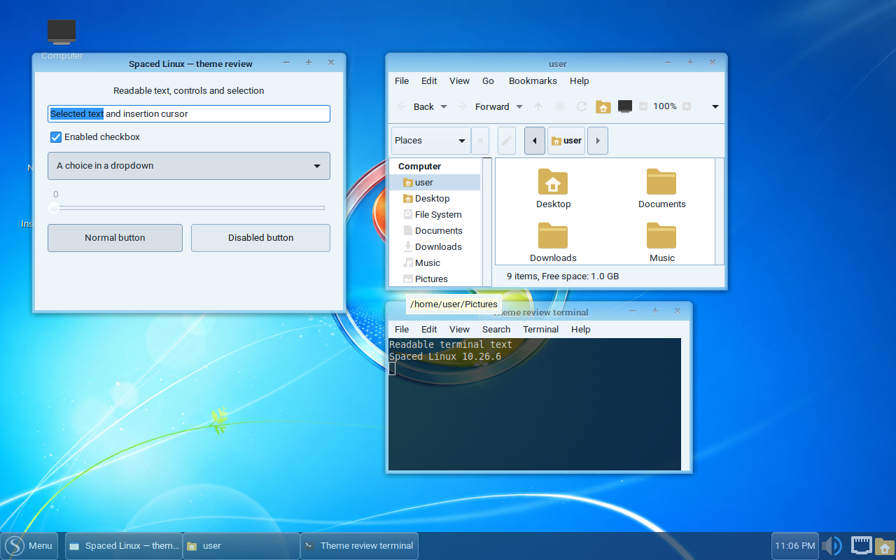
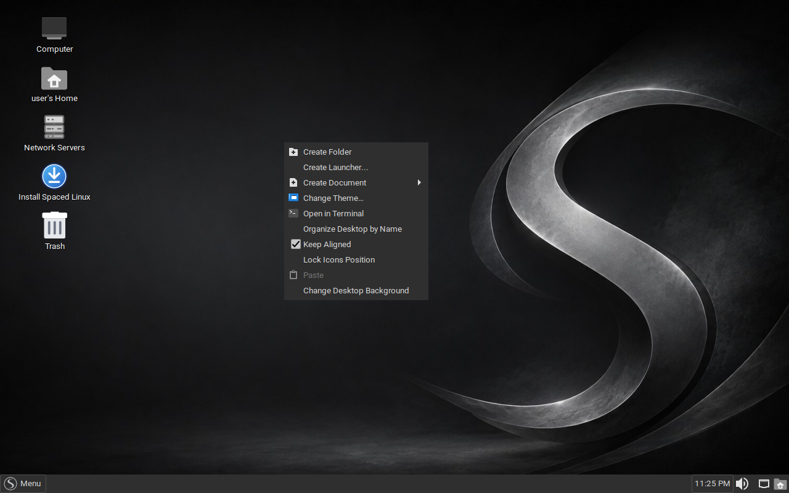
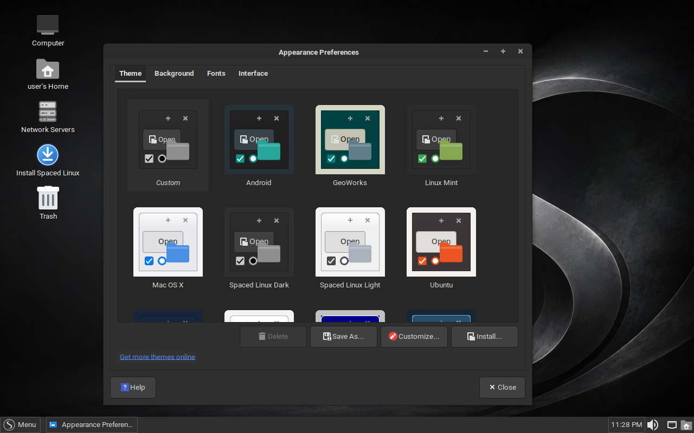
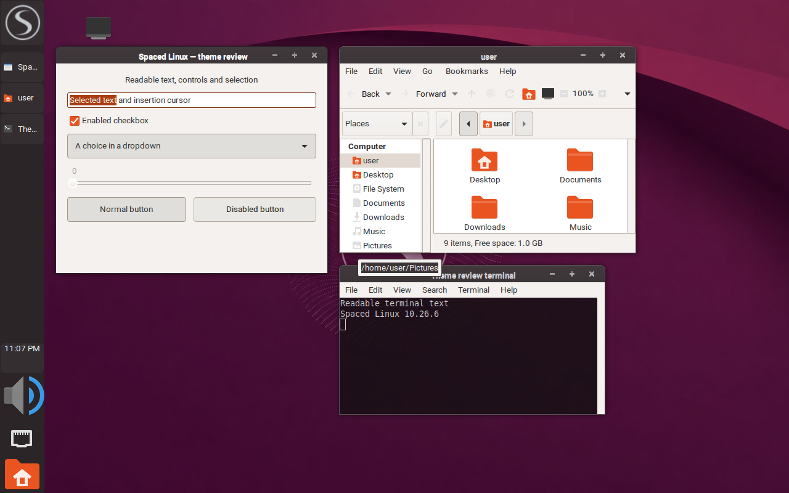

Spaced Linux **10.26.6 is available now**, with a new ISO and matching signed APT packages for existing installations.

This release brings more reliable theme switching, a working restart after removing the installation medium, a Caja file-move fix, and a round of desktop refinements. It also includes everything delivered since 10.26.1: new theme presets, clearer update handling, improved sharing setup, audio-profile persistence, and graphics compatibility fixes.

**[Download Spaced Linux 10.26.6](https://github.com/crhy/spaced/releases/tag/v10.26.6)** · [ISO](https://github.com/crhy/spaced/releases/download/v10.26.6/spaced-linux-10.26.6-amd64.iso) · [SHA-256 checksums](https://github.com/crhy/spaced/releases/download/v10.26.6/SHA256SUMS) · [Website](https://spacedlinux.com)


*Windows 7 Light, with Caja, terminal and GTK controls in the final ISO's theme validation session.*

### What's new in 10.26.6

- **Theme switching stays on Compiz.** A window-decoration race found during VirtualBox testing is fixed. Qt and LibreOffice theme settings now reach the desktop session too.
- **Installation finishes with a reliable restart.** The final key press or click still works after the live medium is removed, even if Xorg exits.
- **Caja keeps the filename you choose.** Moving a file between filesystems and renaming it in the conflict dialog no longer repeats the original conflict.
- **Themes are easier to find.** Right-click the desktop for **Change Theme…**, with clearer names such as Windows 7 Light and Dark.
- **More desktop polish.** A large red X for xkill, finer white Compiz paint-fire defaults, GDebi for downloaded `.deb` packages, and the `spaced-open-target` shortcut helper.
- **More careful graphics selection.** GTX 10-series/Pascal cards are never offered a driver newer than the compatible 580 branch by Spaced GPU Driver Manager.
- **A smaller live filesystem.** Improved squashfs compression; the final ISO is 1,632,811,008 bytes, about 1.63 GB.


*Open the theme chooser directly from the desktop.*


*The theme chooser on a fresh 10.26.6 live desktop.*

### Coming from 10.26.1?

The companion comment below contains **every published changelog entry after 10.26.1 through 10.26.6**, including the intervening APT-only revisions and the separate Spaced Welcome 0.1.19 delivery, plus more screenshots. The main additions include Ubuntu and Windows 7 presets, automatic terminal and wallpaper matching, better update progress and recovery, sharing-password setup, saved sound-card profiles, working Help buttons, improved title-bar hit areas, and Roboto fonts.


*Ubuntu preset, captured from the final ISO during theme validation.*

### Upgrade or install

Existing users can open **Spaced Update**, check **OS Release**, and install 10.26.6. The signed APT repository contains the matching `10.26.6-1` packages and `spaced-wallpapers 2026.10-2`. If the updater is not available, the package upgrade can also be run in a terminal:

```sh
sudo apt update
sudo apt full-upgrade
```

Reboot after the upgrade to load the updated desktop session and graphics components. For a fresh installation, download the ISO and compare its SHA-256 with:

```text
bed3263b2d61f85e292eb86f34bb14969618215b77d667be60139e7436154617
```

### What was verified

The published ISO download matches that checksum. Public APT signatures and all 15 new package downloads were verified. Repository validation passed **244 unit tests and two GTK runtime tests**. The final ISO passed KVM and VirtualBox checks in both BIOS and UEFI modes, with **all 13 themes in each configuration: 52 theme checks**.

Separate candidate tests covered a full Calamares installation, the cross-filesystem Caja regression, and restart after actual ISO ejection. SMB checksum transfers and desktop file operations passed against another Spaced Linux machine. Actual Windows-client discovery/authentication and affected physical NVIDIA/AMD hardware remain unverified; the related hardware and partial-fix issues remain open.

[Detailed release review](https://github.com/crhy/spaced/blob/v10.26.6/docs/10.26.6-RELEASE-REVIEW.md) · [Validation archive](https://github.com/crhy/spaced/releases/download/v10.26.6/spaced-linux-10.26.6-validation.tar.gz) · [Report an issue](https://github.com/crhy/spaced/issues)

Screenshots above and in the comment are unretouched captures of the final 10.26.6 ISO. Theme-validation captures deliberately include ordinary controls, Caja and a terminal so the colors and contrast can be inspected.
