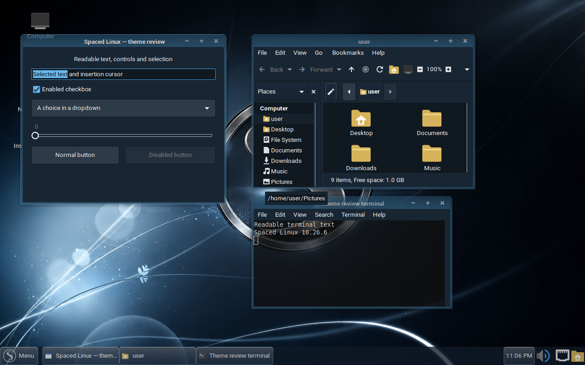
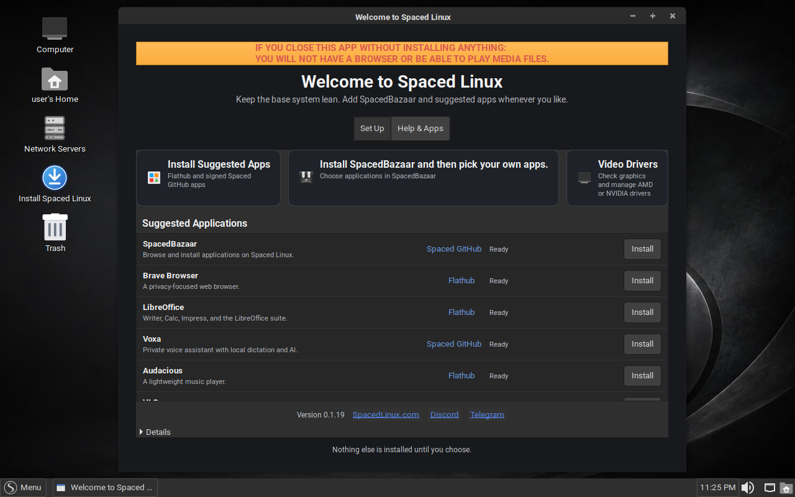
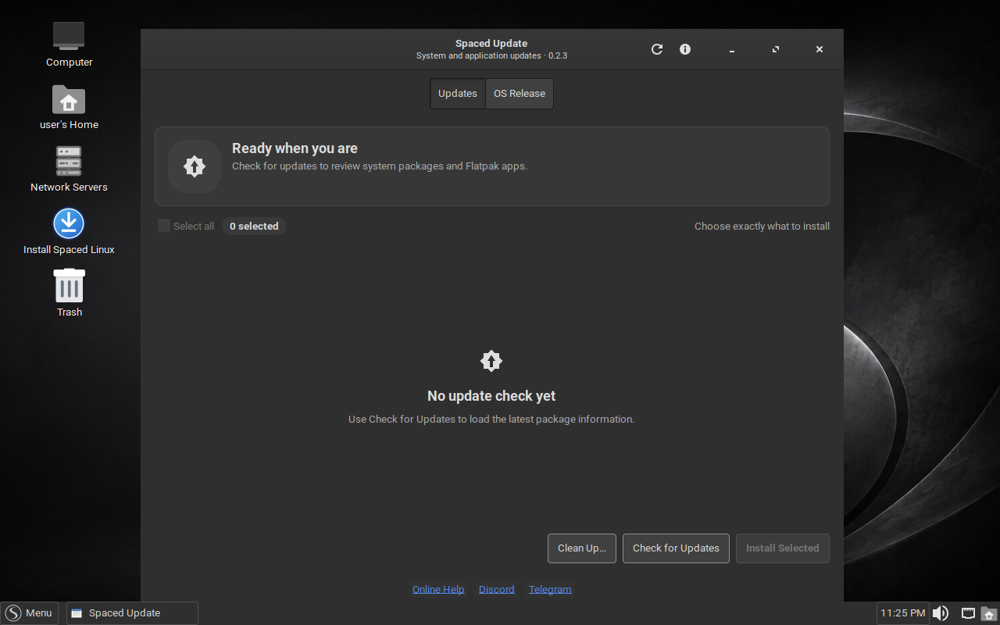
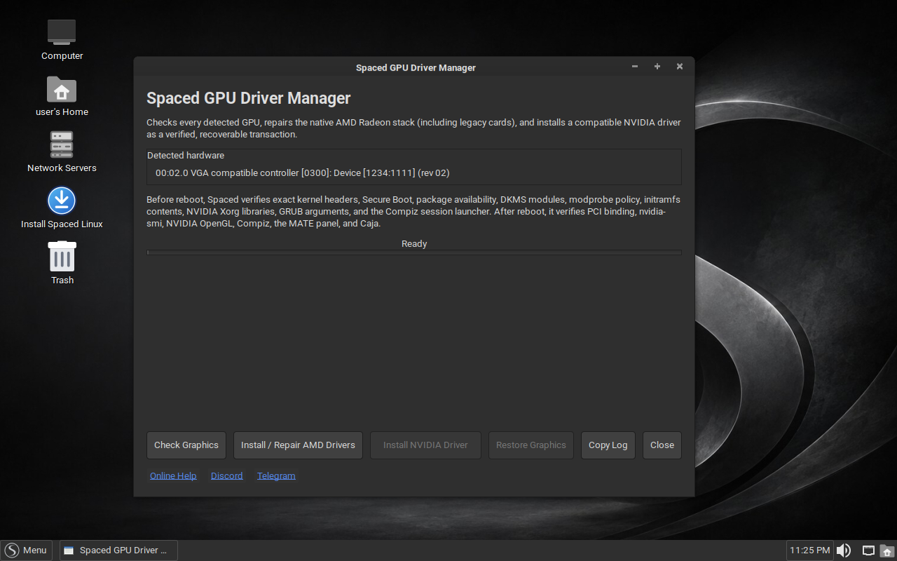
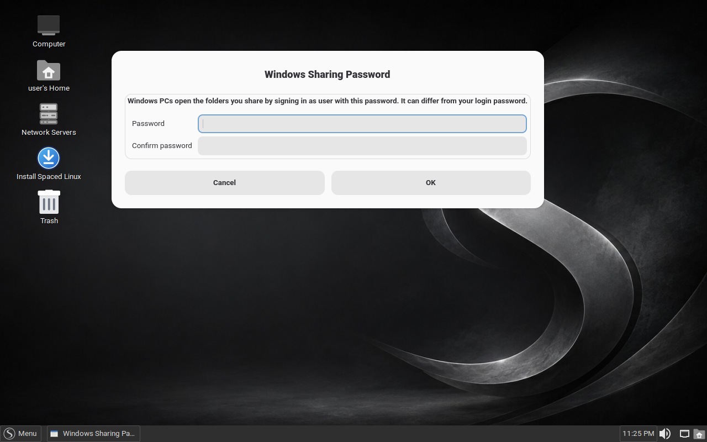
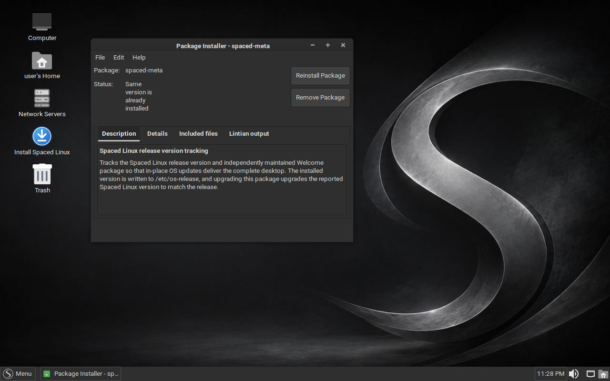

## All published fixes and changes since 10.26.1

This covers **10.26.2 through 10.26.6**, including `10.26.3-2`, `10.26.5-2` and `10.26.5-3`. The entries below reproduce the published [project changelog](https://github.com/crhy/spaced/blob/v10.26.6/CHANGELOG.md), preserving the delivery channel and original dates. Spaced Welcome is a separate component; its 0.1.19 change is identified accordingly. Changes already delivered in 10.26.1 are outside this comparison.

Historical entries describe the fixes delivered, rather than claiming all hardware and client combinations were tested. In particular, the Windows sharing changes are included, but an actual Windows client was not available for this release's end-to-end verification. Physical GPU validation and the remaining portions of #334 and #351 are still open. See the [release review](https://github.com/crhy/spaced/blob/v10.26.6/docs/10.26.6-RELEASE-REVIEW.md) for the exact scope.

### A look at the changes

*Windows 7 Dark: coordinated GTK controls, Caja, terminal, decorations and panel, captured during final-ISO theme validation.*

*Spaced Welcome 0.1.19 on a fresh live profile. Applications already installed get Open buttons; this fresh profile offers Install.*

*Spaced Update 0.2.3, showing the Updates tab before an update check. The releases below add real APT progress, release notes, one-time package repair/retry, and a separate warning when only a Flatpak update fails.*

*The driver manager in the final ISO. This capture detects a virtual graphics adapter; it is an interface illustration, not a physical NVIDIA or AMD test.*

*Set a separate sharing password from System → Preferences. The accompanying service and network-readiness fixes are listed below.*

*GDebi is included for `.deb` files. This example opens the already-installed release package without reinstalling or removing it.*

### Complete release-by-release record

## 10.26.6 - 2026-10-23

Prepared for the 10.26.6 ISO and `10.26.6-1` APT packages. Includes the
Samba network-ready fix first delivered as `10.26.5-3` (#344).

- Keep Compiz running when changing themes. Protecting window-decoration
  pixmaps during import fixes a race that could switch the session to Marco,
  reproduced during Windows 7 theme selection in VirtualBox.
- Restart reliably after removing the installation medium. A small resident
  input handler survives the loss of the live filesystem and Xorg, so the
  final key press or mouse click can still restart into the installed system.
- Backport MATE Caja's upstream fix for moving a file between filesystems
  after renaming it in the conflict dialog. Caja now preserves the chosen
  name instead of asking about the original conflict again (upstream PR #1888).
- Qt and LibreOffice applications follow the Spaced theme again. The theming
  variables in `/etc/profile.d/spaced-application-theming.sh` never reached
  the desktop because `/etc/X11/Xsession` does not read `/etc/profile.d`; a
  new `Xsession.d` script loads them into every session (#339).
- Right-click the desktop and choose **Change Theme…** to open the theme
  chooser (#346).
- Simpler theme names everywhere they are shown: Windows 7 Light, Windows 7
  Dark, Windows XP, Windows 11 Light and Dark, Mac OS X, Ubuntu, Linux Mint,
  GeoWorks, Android and more. Theme IDs are unchanged, so existing settings
  keep working (#347). The renamed background catalog ships in
  `spaced-wallpapers 2026.10-2`, required by the matching APT packages.
- xkill now shows a big red X with white highlights and a black shadow
  instead of X11's tiny fallback glyph, through a new `Spaced-Cursors` theme
  built on Adwaita (#356).
- New Compiz "paint fire" defaults: finer white fire with more particles and
  Shift+Super+right-click to clear. Existing accounts get them only where the
  Compiz default is still in place (#353).
- Spaced GPU Driver Manager never gives a GTX 10-series (Pascal) card a driver
  newer than the 580 branch, even if NVIDIA's repository is still enabled from
  an earlier run; it installs Devuan's compatible driver or keeps the current
  one (#334).
- New `spaced-open-target` helper for keyboard shortcuts: point a custom
  shortcut at a script, an app ID (Flatpaks included) or any file, and it runs
  or opens it in its default app (#351).
- GDebi is preinstalled and opens downloaded `.deb` packages.
- Smaller ISO: the live filesystem uses 1 MiB squashfs blocks and the x86 BCJ
  filter, measured at 131 MB (8.4%) smaller on the 10.26.5 tree
  (`docs/10.26.6-IMAGE-SIZE.md`).

## 10.26.5-3 - 2026-10-20

Delivered to installed systems through the `10.26.5-3` APT packages.

- Retry Samba after NetworkManager has actually brought an interface up. This
  removes the Wi-Fi boot race that could leave a discoverable Spaced computer
  refusing Windows file-sharing connections until another reboot (#344).

## 10.26.5-2 - 2026-10-20

Delivered to installed systems through the `10.26.5-2` APT packages and
included in the final 10.26.5 ISO.

- Make every newly opened MATE Terminal immediately use the active theme
  instead of inheriting stale colors from its shared factory process. Dark
  presets now use neutral gray on black, and Spaced Light and Dark retain 25%
  background transparency.
- Let the running theme monitor discover presets installed during the current
  desktop session.
- Switch registered wallpapers automatically without MATE Appearance showing
  a separate confirmation prompt.

## 10.26.5 - 2026-10-20

Prepared for the 10.26.5 ISO and `10.26.5-1` APT packages.

- Add **Spaced** and **Compiz** to Enchant's per-user dictionary for new and
  existing profiles, without overwriting words added by the user (#333).
- Remember each PulseAudio card's selected hardware profile, including the
  analog or digital profile chosen for a USB DAC, and restore it after login
  or when the device is reconnected (#336).
- If an OS update fails while configuring packages, repair pending dpkg state,
  validate dependencies and retry the exact transaction once. Persistent
  errors still stop and remain visible; the updater never loops (#337).
- Rename the Nvidia installer to **Spaced GPU Driver Manager**, add a guarded
  Nvidia 580 compatibility path for Pascal/GTX 10-series cards, and include
  the native Radeon/ATI compatibility drivers for older AMD hardware.
- Add polished Spaced Ubuntu, Windows 7 and Windows 7 Aero Dark presets with
  coordinated panel, Brisk Menu, terminal, window-decoration and application
  colors. Improve contrast and cross-toolkit light/dark behavior throughout
  the theme collection.
- Consolidate all Spaced wallpaper files and references under
  `/usr/share/backgrounds/spaced`, eliminating duplicate artwork.
- Refresh the website theme gallery and screenshots.

## 10.26.4 - 2026-10-18

Delivered through the 10.26.4 ISO and `10.26.4-1` APT packages.

- Remove the obsolete deb822 Spaced repository entry after an upgrade only
  when it exactly duplicates the signed package-owned source. Customized
  repository entries are preserved (#316).
- Make Help buttons in Screenshot and the MATE control-center tools open the
  installed MATE manual by including Yelp and `mate-user-guide` (#315).
- Give Caja's inline rename field an explicit dark surface, white text and a
  white insertion caret on the desktop, and use the theme text color for
  rename carets in ordinary Caja windows (#313, #318).
- Exclude Marco's transparent resize area from window screenshots by default,
  removing the unwanted border around captures (#301).

## 10.26.3-2 - 2026-10-15

- Spaced Update (0.2.3) no longer reports "System update failed" when the
  system update succeeded but one of your Flatpak apps could not update, for
  example a locally built app whose source is older than the installed copy.
  It now finishes with a warning and names the app in Technical details.
  Delivered through Spaced Update (APT packages `10.26.3-2`); no new ISO.

## 10.26.3 - 2026-10-14

Delivered through the 10.26.3 ISO and `10.26.3-1` APT packages, with the X
server rebuilt as `2:21.1.25-1devuan1+spaced10.26.3`.

- Fix the desktop not starting on AMD graphics after updating. X server
  21.1.25 changed an internal structure without telling drivers, so the
  amdgpu driver crashed the X server at startup and only a text login
  appeared. Spaced now ships 21.1.25 with the upstream fix (the same change
  as Debian's `2:21.1.25-2`), keeping all of 21.1.25's security fixes, and
  refuses to install the broken `2:21.1.25-1devuan1` from Spaced Update or
  `apt`. If you held the X server packages, run
  `sudo apt-mark unhold xserver-common xserver-xorg-core xvfb` and update;
  remove any `modesetting` workaround file you added afterwards so TearFree
  returns (#298).
- Fix folder sharing with "Everyone" (#297):
  - The Samba service now starts at every boot; before, a reboot could leave
    shared folders refusing connections.
  - Guests can open folders shared from inside your home folder. Home folders
    change from 0700 to 0711: others can pass through to a shared folder but
    cannot list your home.
  - New **Windows Sharing Password** (System > Preferences): Windows 10 and 11
    refuse guest access, so they sign in to your shares with your user name
    and this password.
  - Windows PCs now list Spaced computers under **Network**.
  - Gigolo's Open, and anything else opening a folder, uses Caja again instead
    of VSCodium.
- Spaced Update's "What's new" window now shows the release notes; it was
  empty (#295).
- Website: the ISO fits on a 2 GB USB stick, and the install steps mention F2
  or Delete for the BIOS setup (#296).
- New test tools: `scripts/tests/samba-network-test.sh` checks file sharing
  between real machines, and `scripts/tests/xorg-amdgpu-headless-test.sh`
  checks the X server on an AMD GPU.

## 10.26.2 - 2026-10-08

Delivered through the 10.26.2 ISO and `10.26.2-1` APT packages, with Compiz
`2:0.8.18-9+spaced10.26.2` and Spaced Welcome 0.1.19.

- New Brave profiles get two folders on the bookmark bar instead of five
  separate links: “🚀 Spaced” (project links, each with a symbol, now with
  Voxa at voxaai.me) and “📰 News” (Voat first, then ten news sites ordered by
  how quickly their front pages load) (#278, #289). Existing profiles are not
  changed.
- Link Spaced Linux's DistroWatch page from the Brave bookmarks, the website
  and the README.
- Website: the home page now leads with what a newcomer gets (a desktop you
  can talk to, no account), adds a three-step install section with a direct
  ISO link and checksum, a section for people coming from Windows, and a Voxa
  section.
- Make the minimize, maximize and close buttons easier to hit in all eleven
  themes: each clickable box grows from 24x24 to 32x27 px, the 4 px dead gaps
  between them and the 3 px dead strip above them are gone, and the icons and
  the title bar keep their size. `scripts/tests/titlebar-hit-test.sh` measures
  the boxes on a virtual screen (#279).
- Rebuild Compiz as `2:0.8.18-9+spaced10.26.2` with a fix to its window
  decorator: the click area of each title-bar button was displaced 10 px left
  of and 10 px below the drawn button, so only the lower-left part of minimize,
  maximize and close responded. Source and patch are under `patches/compiz/`
  (#279).
- Turn the remaining Brave reporting off by policy — Safe Browsing, extended
  reporting, metrics, URL-keyed data collection, search suggestions, alternate
  error pages, background mode, default-browser setting, promotional tabs,
  feedback surveys and AI chat — and disable Wallet, VPN and Talk. Private
  windows with Tor stay available (#282).
- Make a selected folder or icon on the desktop easy to see in every theme. A
  rule that keeps the desktop window transparent also erased the selection
  colour, so the selected icon was tinted almost black and its label box
  nearly vanished. Selected desktop items now use the theme's selection colour,
  darkened enough for the white label text, both while the desktop has the
  keyboard and after another window takes it (#275).
- Clicking a magnet or torrent link with no app to open it now asks "qBittorrent
  is needed to open this link. Install it now?" and opens Spaced Bazaar on
  qBittorrent's page when you choose Install. Once qBittorrent or any other
  torrent app is installed, the link goes straight to it (#290).
- "Find More in Software" in the "Open With" window now opens Spaced Bazaar;
  it used to do nothing, because it starts GNOME Software, which Spaced does
  not ship (#290).
- Spaced Update opens on the OS Release page and checks for a new release by
  itself. Checking for updates no longer asks for a password; installing still
  does. The progress bar follows APT's real download and install progress and
  names what it is working on, and "What's new" shows the release notes of the
  version found inside the app (#277).
- Spaced Welcome 0.1.19: buttons say "Open" for an application that is already
  installed and start it, and "Install" for one that is not, on both the Set Up
  and Help & Apps pages, including SpacedBazaar. A red notice at the top warns
  that closing Welcome without installing anything leaves no browser or media
  player (#285). Delivered by the Spaced Welcome release.
- Roboto replaces DejaVu Sans as the default font for applications,
  documents, the desktop and window titles (Roboto Bold). It fits about 12%
  more text on a line at the same line height. Fonts you chose yourself in
  Appearance are kept. `docs/font-comparison/` compares the fourteen
  candidates as the desktop renders them (#286).

## Release engineering and supporting changes

The release review also added opt-in live-VM theme checks for both hypervisors, retained screenshots and runtime reports, pinned rebuilt source artifacts by SHA-256, and documented the Caja patch and its removal condition. The published validation archive and signed APT repository make the shipped bytes independently checkable. Website theme labels and release/download links now match 10.26.6.

The squashfs saving above was measured on the **10.26.5 tree**, not as a byte-for-byte size comparison between the two published ISOs. The original “eleven themes” title-bar entry refers to the collection at that time; final 10.26.6 validation covers 13 presets.

[Complete source comparison: v10.26.1…v10.26.6](https://github.com/crhy/spaced/compare/v10.26.1...v10.26.6) · [Download 10.26.6](https://github.com/crhy/spaced/releases/tag/v10.26.6)
