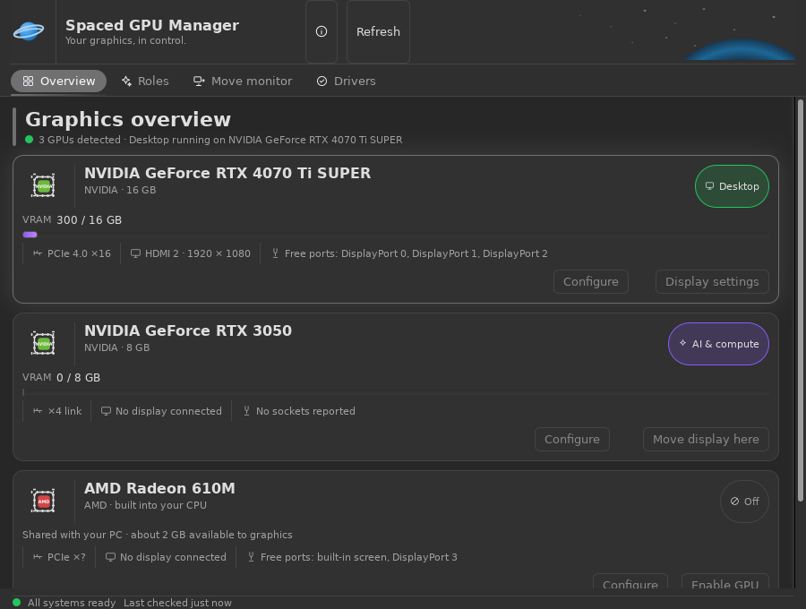
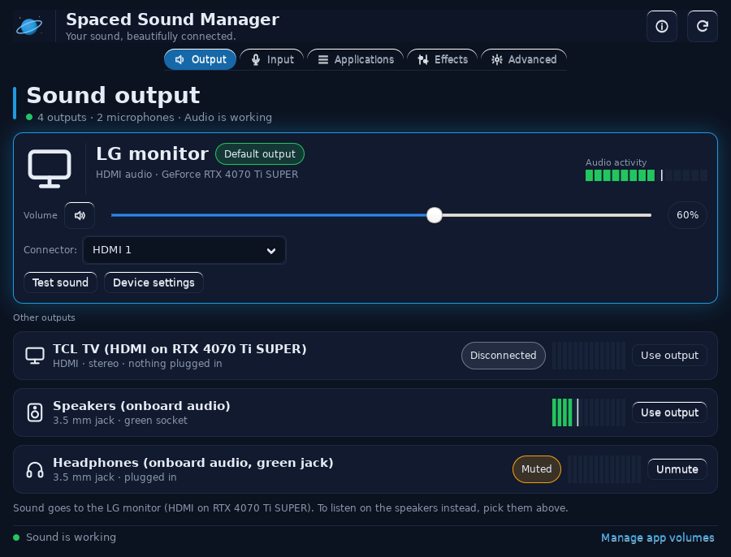

New Spaced apps for your graphics cards and your sound, a new look shared by every Spaced app, and SpacedBazaar that picks the install format that runs best.

**Already on 11.26.x?** Open **Spaced Update** and install, or run `sudo apt update && sudo apt full-upgrade`. **Starting fresh?** Download the ISO from the [11.26.4 release](https://github.com/crhy/spaced/releases/tag/v11.26.4) and check it: `sha256sum spaced-linux-11.26.4-amd64.iso` must print `fbfe614c492c2a77430938691a7a3974205b6e08c6dd398b49f01e66dbb322a0`.

## What you will notice

- **Spaced GPU Manager, rebuilt.** One card per graphics card with its memory, PCIe link, display and free ports in plain words, and a role for each card (Desktop, AI & compute, Games, Off). Choosing which card runs the desktop is a trial: if you don't confirm it within three minutes, it rolls back by itself (#426).

  

- **Spaced Sound Manager** replaces Sound Preferences in the menu. Your devices have real names ("LG monitor", "Speakers", "Headphones") instead of driver strings, with level meters, volume, connector choice and one-click output switching. It works on PulseAudio and PipeWire, and opens a microphone for a meter only on the Input page (#429).

  

- **One look for Spaced apps.** The GPU and Sound Managers share a header, tabs with icons, cards and status labels, in your desktop theme's colours, light or dark. Spaced Monitor and Spaced RGB come next.
- **SpacedBazaar 0.1.16 recommends the best format.** Every app page starts with *Recommended for you*: system package, Flatpak or AppImage, and why. FreeCAD gets the AppImage because its Flatpak freezes on this desktop. The other formats are listed underneath if you prefer one. AppImages come only from the project's official releases and only with a matching published SHA-256 (spacedbazaar#35).
- **Network discovery comes back after a late connection**, for Spaced and Windows machines alike (#432).
- **Network printers just appear** on Spaced machines (#435), with the legacy CUPS browsing protocol kept off (CVE-2024-47176).
- **Right-click → Open Terminal Here** is now Spaced's own Caja extension (#302), and panel applets take the panel's own background in every theme (#387).
- **For tinkerers:** an opt-in Wine launcher (`spaced-wine-run`, one prefix per app), a migration report that lists what you'd lose moving from another distro (#417), and an init-script generator for software that only ships a systemd unit (#431).

## Tested before release

Real upgrades of the public 11.26.3 ISO to 11.26.4 from the signed repository, then two upgraded machines copying files over Samba and printing to each other; the same two-machine test on the fresh ISO; BIOS and UEFI live boots in KVM; VirtualBox boots; signed upgrade resolution from 7.26, 11.26, 11.26.1, 11.26.2 and 11.26.3; and 806 automated tests.

## Coming next

- **Spaced Monitor and Spaced RGB** in the new shared look.
- **Voxa 0.1.10:** the voice assistant always answers, and says so out loud if something goes wrong, checked by a 30-question offline test.
- **A fix for Flatpak apps occasionally not starting** after a reboot (#436).
- **The migration assistant** that moves your settings and data from Debian, Devuan and Ubuntu derivatives (#417).

Thank you for the reports that made this release better. Tell us how 11.26.4 runs on your hardware, and how the new GPU and Sound Managers work on your cards and devices.
